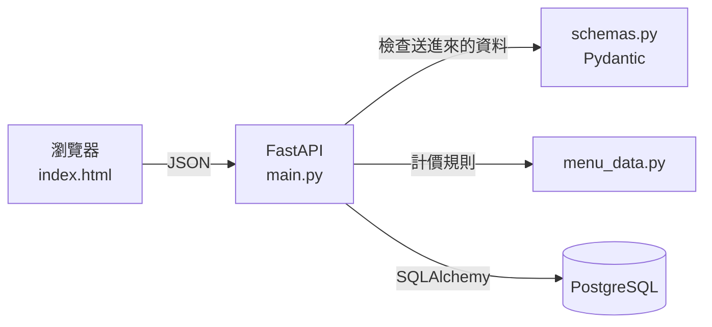

# 訂飲料系統 drink_order

一起訂飲料時，開一張單、把連結丟到群組，大家各自點，價格由後端依菜單和加料規則計算，最後一鍵結單。

這是我轉職後端工程師培訓的結訓專題，重點放在 **API 設計、資料庫設計，以及「價格只信任後端」的計價規則**。


**線上版**：https://drink-order-8h9v.onrender.com/ （用手機也能直接點）

> 線上版使用 Render 免費方案，閒置 15 分鐘會休眠，休眠後第一次開啟要等大約 1 分鐘。

## 功能

- **開單**：從有菜單的店家清單選一家，建立一張訂單
- **點飲料**：選飲料、尺寸、甜度、冰塊，可複選加料，另外可以寫備註
- **即時試算**：每次換飲料、尺寸或加料，價格欄都會向後端試算
- **明細**：依點單的人分組，顯示每杯內容、每人小計、總金額與杯數
- **結單**：結單後不能再點，明細仍然可以看
- **菜單看板**：顯示五十嵐 66 項飲料的 M／L 價格，標示不建議做熱飲的品項；點品項可以直接帶入點單

## 技術

| 類別 | 使用 |
| --- | --- |
| 後端 | Python 3.14、FastAPI、Pydantic |
| 資料庫 | PostgreSQL 16、SQLAlchemy 2（ORM） |
| 環境 | Docker Compose（資料庫）、python-dotenv |
| 前端 | 原生 HTML、CSS、JavaScript（單一檔案，由 FastAPI 提供） |
| 版本控制 | Git、GitHub（功能分支、Pull Request） |
| 部署 | Render（Web Service）、Neon（雲端 PostgreSQL），兩者都在新加坡機房 |

## 架構



| 環境 | 後端跑在哪 | 資料庫 | 設定從哪來 |
| --- | --- | --- | --- |
| 開發 | 自己電腦的 uvicorn | Docker 容器 | `.env` 檔 |
| 正式 | Render | Neon | Render 後台的環境變數 |

同一份程式碼，靠環境變數切換連到哪個資料庫、用哪組結單密碼，程式本身不用知道自己跑在哪個環境。

## 快速開始

需要先安裝：Python（開發時使用 3.14）、Docker Desktop、Git。

```bash
git clone https://github.com/elike143/drink_order.git   # 下載專案
cd drink_order                                           # 進到專案資料夾

cp .env.example .env                                     # 複製環境變數範本，再把 .env 裡的 change_me 換成自己的密碼

python -m venv venv                                      # 建立虛擬環境
source venv/Scripts/activate                             # 啟動虛擬環境（Windows Git Bash；macOS / Linux 用 source venv/bin/activate）
pip install -r requirements.txt                          # 安裝套件

docker compose up -d                                     # 啟動 PostgreSQL
docker compose ps                                        # 等到 STATUS 顯示 healthy

uvicorn app.main:app --reload                            # 啟動後端；第一次啟動會自動建表並寫入菜單
```

啟動之後：

| 網址 | 內容 |
| --- | --- |
| http://127.0.0.1:8000/ | 點餐網頁 |
| http://127.0.0.1:8000/docs | API 文件，可以直接在頁面上測試 |

## API

| 方法 | 路徑 | 說明 | 成功 |
| --- | --- | --- | --- |
| GET | `/shops` | 有菜單的店家清單 | 200 |
| GET | `/menu?shop=五十嵐` | 某家店的菜單 | 200 |
| GET | `/price?shop=&drink=&size=&toppings=` | 試算一杯的價格，只算不存 | 200 |
| GET | `/orders` | 所有訂單 | 200 |
| POST | `/orders` | 開一張新訂單 | 201 |
| GET | `/orders/{order_id}/cups` | 某張訂單的所有飲料 | 200 |
| POST | `/orders/{order_id}/cups` | 點一杯飲料 | 201 |
| POST | `/orders/{order_id}/close` | 結單 | 200 |

常見錯誤：找不到訂單或菜單回 **404**；訂單已結單、菜單上沒有這杯、不能做熱飲的飲料點熱飲回 **400**；送來的欄位格式不對回 **422**。

## 加料計價規則

價格一律由後端用同一個 `topping_price` 計算。點單時前端送來的 `price` 會被忽略並重算，試算 API `/price` 也呼叫同一個函式，所以畫面上的價格和實際收的錢一定一致。

| 飲料種類 | 包含哪些飲料 | 珍珠／波霸／椰果（每一種） | 布丁／冰淇淋 |
| --- | --- | --- | --- |
| 純茶 | 茉莉綠茶、阿薩姆紅茶、四季春青茶、黃金烏龍 | M +5、L +10 | +15 |
| 有料 | 「找口感」分類的飲料 | +10 | +15 |
| 一般 | 其他全部 | 免費 | +15 |

例：阿薩姆紅茶 L，加珍珠和布丁 = 40 + 10 + 15 = **65**。

不在規則裡的加料會被拒絕，避免新增加料時忘了訂價格而變成免費。

## 資料表

| 資料表 | 存什麼 | 重要欄位 |
| --- | --- | --- |
| `orders` | 訂單 | `shop_name`、`created_at`（資料庫自動填入）、`is_open` |
| `cups` | 每一杯飲料 | `order_id`（外鍵 → `orders.id`）、`size`、`sugar`、`ice`、`toppings`（PostgreSQL 陣列）、`add`（備註）、`price` |
| `menu_items` | 菜單 | `shop`、`category`、`name`、`price_m`、`price_l`、`hot_ok` |

## 專案結構

```
drink_order/
├── app/
│   ├── main.py          # API 路由
│   ├── models.py        # 資料表定義（SQLAlchemy）
│   ├── schemas.py       # 送進來、送出去的資料格式（Pydantic）
│   ├── database.py      # 資料庫連線設定
│   ├── menu_data.py     # 五十嵐菜單與加料計價規則
│   └── static/
│       └── index.html   # 點餐網頁
├── docker-compose.yml   # PostgreSQL 容器設定
├── requirements.txt     # Python 套件
└── .env.example         # 環境變數範本（真正的 .env 不進版本控制）
```

## 部署

正式環境：Render 跑後端，Neon 放資料庫。部署不需要改程式碼，只要在 Render 設定環境變數。

| Render 設定 | 值 |
| --- | --- |
| Branch | `main` |
| Region | Singapore（跟 Neon 同一區，查詢延遲最低） |
| Build Command | `pip install -r requirements.txt` |
| Start Command | `uvicorn app.main:app --host 0.0.0.0 --port $PORT` |

| 環境變數 | 說明 |
| --- | --- |
| `DATABASE_URL` | Neon 的連線網址，開頭要從 `postgresql://` 改成 `postgresql+psycopg://`（專案用的是 psycopg 3） |
| `ADMIN_TOKEN` | 正式環境的結單密碼，跟開發環境的不同 |
| `PYTHON_VERSION` | 跟本機開發用的版本一致 |

啟動時會自動建表並寫入菜單，所以第一次部署不用另外初始化資料庫。

## 資安與設計重點

- **價格只信任後端**：前端送來的價格一律重算
- **參數化查詢**：所有查詢都透過 SQLAlchemy ORM，避免 SQL injection
- **資料驗證**：甜度、冰塊、尺寸、加料用 Pydantic 的 `Literal` 限制合法值
- **結單要密碼**：結單 API 要在 header 帶 `X-Admin-Token`，用 `secrets.compare_digest` 比對，避免從回應時間猜出密碼；密碼錯誤回 403
- **機密不進版控**：資料庫密碼和結單密碼放在 `.env`，已列入 `.gitignore`
- **開發和正式環境分開**：兩邊的資料庫密碼、結單密碼都不同；正式環境的密碼只存在 Render 後台
- **設定缺了就不啟動**：用 `os.environ["..."]` 讀設定，少了必要的環境變數會直接啟動失敗，不會帶著錯誤設定上線
- **資料庫只開放本機**：Docker 只綁定 `127.0.0.1:5432`

## 已知限制與未來規劃

- **點單沒有身分驗證**：結單已經要密碼，但拿到連結的人都能開單和點單。之後可以加登入，或每張單產生專屬連結
- **免費方案會休眠**：Render 免費方案閒置 15 分鐘後休眠，第一次開啟較慢
- **資料表變更要重建資料庫**：目前用 `create_all` 建表，它不會修改已存在的表。之後改用 Alembic 管理資料庫遷移
- **加料規則目前只適用五十嵐**：多店家時要改成依店家設定規則
- **後台分析**：預計用 Pandas 統計熱門飲料、加料與金額
