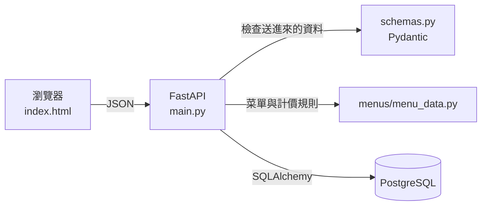

# 部署

## 架構



| 環境 | 後端跑在哪 | 資料庫 | 設定從哪來 |
| --- | --- | --- | --- |
| 開發 | 自己電腦的 uvicorn | Docker 容器 | `.env` 檔 |
| 正式 | Render | Neon | Render 後台的環境變數 |

同一份程式碼，靠環境變數切換連到哪個資料庫，程式本身不用知道自己跑在哪個環境。


## Render 與 Neon

正式環境：Render 跑後端，Neon 放資料庫。部署不需要改程式碼，只要在 Render 設定環境變數。

| Render 設定 | 值 |
| --- | --- |
| Branch | `main` |
| Region | Singapore（跟 Neon 同一區，查詢延遲最低） |
| Build Command | `pip install -r requirements.txt` |
| Start Command | `uvicorn app.main:app --host 0.0.0.0 --port $PORT` |

| 環境變數 | 說明 |
| --- | --- |
| `DATABASE_URL` | Neon 的連線網址，開頭要從 `postgresql://` 改成 `postgresql+psycopg://`（專案用的是 psycopg 3） |
| `PYTHON_VERSION` | 跟本機開發用的版本一致 |

啟動時會自動建表，並把資料庫的菜單同步成 `app/menus/` 裡的內容（新增、更新價格、刪掉檔案裡已經沒有的品項），所以第一次部署不用另外初始化資料庫，之後改菜單也只要重新部署。


## 專案結構

```
drink_order/
├── app/
│   ├── main.py          # API 路由
│   ├── models.py        # 資料表定義（SQLAlchemy）
│   ├── schemas.py       # 送進來、送出去的資料格式（Pydantic）
│   ├── database.py      # 資料庫連線設定
│   ├── menus/
│   │   ├── menu_data.py # 啟動時同步菜單到資料庫、加料與整杯計價規則
│   │   ├── fifty_lan.py # 五十嵐菜單
│   │   └── de_zheng.py  # 得正菜單與加料價格
│   └── static/
│       └── index.html   # 點餐網頁
├── docker-compose.yml   # PostgreSQL 容器設定
├── requirements.txt     # Python 套件
└── .env.example         # 環境變數範本（真正的 .env 不進版本控制）
```


## 資安設定

- **價格只信任後端**：前端送來的價格一律重算
- **參數化查詢**：所有查詢都透過 SQLAlchemy ORM，避免 SQL injection
- **資料驗證**：甜度、冰塊、尺寸、加料用 Pydantic 的 `Literal` 限制合法值
- **機密不進版控**：資料庫密碼放在 `.env`，已列入 `.gitignore`
- **開發和正式環境分開**：兩邊的資料庫密碼不同；正式環境的密碼只存在 Render 後台
- **設定缺了就不啟動**：用 `os.environ["..."]` 讀設定，少了必要的環境變數會直接啟動失敗，不會帶著錯誤設定上線
- **資料庫只開放本機**：Docker 只綁定 `127.0.0.1:5432`

